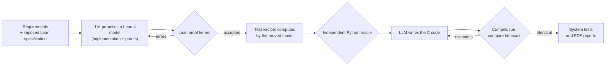

# Formally verified RF spur removal

**Phase-modulation spur removal in fixed point: Lean 4 proofs, and C code produced by an LLM agent that Lean keeps honest.**

A parasitic tone phase-modulates a baseband carrier and creates spurs at multiples of the tone frequency. This project estimates the modulation index from Bessel-function relations, derotates the signal, and brings the spurs from **+8 dBc down to about −78 dBc** (worst case over the validated range), using only integer arithmetic.

It is also a worked example of a method: **critical code can be produced with an LLM when correctness is gated by formal proof.** The engineer writes the specification as Lean theorems; the LLM only proposes a Lean 4 model (implementation and proof scripts); Lean's proof kernel does all the proving and verification, and its errors are fed back to the LLM until code and proof converge. The C code is then generated from the proved model and checked bit-exact against vectors computed by Lean.


*Spectrum before (red) and after (green) correction, from the fixed-point reference in `spur_pm_prototype.py` (N = 4096, SNR 70 dB). The spur at ±37 bins and its harmonics disappear; what remains is the noise floor. Regenerate with `python make_readme_figures.py`.*

---

## Contents

1. [The algorithm](#the-algorithm)
2. [Results](#results)
3. [How the code is produced and verified](#how-the-code-is-produced-and-verified)
4. [What Lean proves, and what it does not](#what-lean-proves-and-what-it-does-not)
5. [Project status](#project-status)
6. [Repository layout](#repository-layout)
7. [Quick start](#quick-start)
8. [Fixed-point design](#fixed-point-design)
9. [Limits and trusted base](#limits-and-trusted-base)
10. [Author and license](#author-and-license)

---

## The algorithm

A complex baseband carrier, assumed to be a pure sinusoid over the block, is phase-modulated by a parasitic spur of normalised frequency D = f<sub>spur</sub> / f<sub>s</sub>, modulation index β and phase φ. With C the carrier amplitude, its samples are

<p align="center">
  <picture>
    <source media="(prefers-color-scheme: dark)" srcset="docs/eq/eq_model_dark.png">
    
  </picture>
</p>

This is the Jacobi–Anger expansion, where J<sub>n</sub> is the Bessel function of the first kind of order n. The carrier loses power (J<sub>0</sub>(β) < 1) and spurs of amplitude J<sub>n</sub>(β) appear at n·f<sub>spur</sub>. Removing them takes three steps on a block of N samples.

### Step 1: correlate

*In words: measure the signal at the carrier (n = 0) and at the first two spur harmonics (n = 1 and 2).*

<p align="center">
  <picture>
    <source media="(prefers-color-scheme: dark)" srcset="docs/eq/eq_corr_dark.png">
    
  </picture>
</p>

### Step 2: estimate the index β and the phase φ

*In words: the ratio between the harmonics gives β, and the phase of c<sub>1</sub> relative to c<sub>0</sub> gives φ.*

The Bessel recurrence

<p align="center">
  <picture>
    <source media="(prefers-color-scheme: dark)" srcset="docs/eq/eq_bessel_dark.png">
    
  </picture>
</p>

ties the three coefficients together, so that

<p align="center">
  <picture>
    <source media="(prefers-color-scheme: dark)" srcset="docs/eq/eq_beta_dark.png">
    
  </picture>
</p>

<p align="center">
  <picture>
    <source media="(prefers-color-scheme: dark)" srcset="docs/eq/eq_phase_dark.png">
    
  </picture>
</p>

This holds for 0 < β < 2.405, where J<sub>0</sub>J<sub>1</sub> > 0, which removes any ambiguity on the phase.

### Step 3: derotate

*In words: undo the phase modulation, sample by sample.*

<p align="center">
  <picture>
    <source media="(prefers-color-scheme: dark)" srcset="docs/eq/eq_derot_dark.png">
    
  </picture>
</p>

The spur and its harmonics vanish and the carrier recovers its full power.

**Assumptions:** pure sinusoidal carrier over the block; known spur frequency; coherent integration (N·D an integer, otherwise the estimate is biased); 0 < β < 2.405 (the first zero of J<sub>0</sub>); noise small compared with the spur.

---

## Results

Residual spur level (highest of harmonics ±1 to ±3) after correction, measured on the fixed-point reference with **8 noise draws per point**, N = 4096, SNR 70 dB:

| β | Spur before (dBc) | After, worst case (dBc) | After, median (dBc) |
| ---: | ---: | ---: | ---: |
| 0.02 | −40.0 | −93.6 | −97.0 |
| 0.3 | −16.4 | −91.2 | −92.9 |
| 1.0 | −4.8 | −85.2 | −86.2 |
| 2.0 | +8.2 | −77.6 | −78.7 |
| 2.3 *(outside the validated range)* | +19.8 | −72.2 | −77.3 |

**Validation criterion: residual spur ≤ −75 dBc for 0.02 ≤ β ≤ 2 at SNR ≥ 70 dB.** It is met on the whole range; near the validity limit (β = 2.405) the estimate degrades, as expected. The residual level is limited by the estimation noise at 70 dB SNR (about −85 dBc around β = 1). Moving β and the derotation angle from Q13 to Q16 gained 8 to 18 dB.


*Numbers and both figures come from the Python fixed-point reference, which uses exactly the integer arithmetic of the generated C. In the system tests of the pipeline, the generated C must reproduce this reference **bit for bit** and meet the −75 dBc criterion.*

---

## How the code is produced and verified



* **The specification belongs to the engineer.** Each module's requirements file (`req_pm_*.txt`) contains an imposed block of Lean theorem statements, checked to compile before any LLM call. The LLM cannot change them: an attempt that redeclares an imposed theorem, or that contains `sorry` or `native_decide`, is rejected before Lean even runs.
* **Lean does the proving.** The LLM only *proposes*; the Lean proof kernel accepts or rejects. Lean's error messages, annotated with the offending source lines, go back to the LLM, and the loop continues until code and proof converge together (or a round or token budget is reached).
* **Vectors come from the proved model, not from the LLM.** A Lean program calls the proved functions on chosen inputs (typical trajectories, limit cases, saturations) and prints the expected outputs. An **independent Python oracle** (`spur_pm_prototype.py`) cross-checks them; a mismatch stops the module.
* **The C code never sees the expected values.** It is compiled and run on the input vectors, and its output must equal the Lean-computed output line for line.
* **Nothing validated is lost.** Each stage reuses what is already proved (the proof is re-checked by Lean on every run); a failed regeneration restores the previous valid proof.
* **Model per module.** `projet_pm.json` can set a more capable model for the hardest modules (`"model"` key); a token budget caps the cost of a run.

---

## What Lean proves, and what it does not

Properties proved in Lean 4 (core library, no Mathlib), per module:

| Module | Role | Theorems | Proved properties |
| --- | --- | ---: | --- |
| `cossin` | Digital oscillator: sine and cosine from a 257-entry table with linear interpolation | 6 | outputs in ±32767; values at cardinal points; odd symmetry; half-turn antisymmetry; cosine equals the sine shifted by a quarter turn; three anchor values (22.5°, 45°, 67.5°) |
| `correlate` | Correlation coefficients c<sub>0</sub>, c<sub>1</sub>, c<sub>2</sub> | 2 | empty input and all-zero input give zero |
| `estimate` | Index and phase estimation (Bessel recurrence) | 7 | exact integer formulas for β (Q16) and the unit phasor (Q15); β within [0, 3]; phasor within ±32767; defined fallbacks when c<sub>1</sub> = 0 or the carrier is absent (c<sub>0</sub> = c<sub>2</sub> = 0) |
| `derot_block` | Derotation of a block | 3 | output length preserved; every sample within [−32768, 32767] (no overflow); empty input |
| `spur_block` | System function: correlation, estimation, derotation | 5 | length, bounds and range properties delegated to the module theorems |

**Not proved by Lean, and validated differently:**

* the numerical accuracy of the sine table and the effectiveness of the algorithm (residual spur level): by simulation and by comparison with an independent reference;
* the equivalence between the C code and the Lean model on all inputs: by bit-exact tests on a finite set of vectors (about 2,200 for the oscillator);
* anything about the C compiler, the Lean toolchain or the generation tools, which form the trusted base.

---

## Project status

| Step | `cossin` | `correlate` | `estimate` | `derot_block` | `spur_block` |
| --- | :---: | :---: | :---: | :---: | :---: |
| Lean proof accepted | ✅ | ✅ | ⏳ | ✅ | ⏳ |
| Vectors, oracle check | ✅ | ✅ | ⏳ | ✅ | ⏳ |
| Generated C, bit-exact | ✅ | ✅ | ⏳ | ✅ | ⏳ |

⏳ `estimate` was first proved with Mathlib and is being redone in core Lean so that all modules can be merged into one library; `spur_block` and the system tests follow. The figures above come from the Python reference, not yet from the generated C.

<!-- Update this table as the pipeline completes; the system-test figure `rapport/spectres.png` is produced by the pipeline itself. -->

---

## Repository layout

```
.
├── projet_pm.json                 project configuration: modules, models, system tests, report settings
├── req_pm_0_vue_densemble.txt     algorithm overview (French)
├── req_pm_0_overview_en.txt       algorithm overview (English)
├── req_pm_1_cossin.txt            per-module requirements, each with its imposed Lean specification
├── req_pm_2_correlate.txt
├── req_pm_3_estimate.txt
├── req_pm_4_derot_block.txt
├── req_pm_5_integration.txt
├── spur_pm_prototype.py           fixed-point Python reference and independent oracles
├── agent_lean_v5.py               specification -> proof loop with Lean
├── agent_mbd_v7.py                vectors -> C code -> bit-exact validation
├── agent_projet_v8.py             whole-project orchestration, system tests, reports
├── agent_rapport.py               PDF reports (French and English)
├── make_readme_figures.py         regenerates the figures in docs/
├── make_equations.py              renders the formulas of this README with LaTeX (docs/eq/)
├── references_lean/               optional reference Lean solutions (off by default)
├── docs/                          figures and formula images used in this README
├── requirements.txt
└── .gitignore
```

Generated at run time and not committed: `lean_out/` (Lean models and proofs), `mbd_out/<module>/` (vectors, `model.c`, `harness.c`, reports), `rapport/` (PDF reports and the system-test figure).

---

## Quick start

**Prerequisites**

* Python 3.10+ and `pip install -r requirements.txt`.
* [Lean 4](https://lean-lang.org/) through `elan`, and a Lake project next to the scripts (core Lean is enough, Mathlib is **not** needed): `lake new lean_project`. The agent looks for `lean_project` next to the scripts and in the parent folders, or in `LEAN_PROJECT_DIR`.
* A C compiler: `gcc`, `clang`, or `pip install ziglang` (no administrator rights needed). It is detected automatically.
* An Anthropic API key in the environment (never commit it).

**Check the figures without any API call or compiler**

```bash
python make_readme_figures.py          # writes docs/spur_spectrum.png and docs/spur_vs_beta.png
python make_equations.py               # re-renders the formulas in docs/eq/ (only needed to edit them; requires pdflatex)
```

**Run the whole pipeline**

```bash
export ANTHROPIC_API_KEY=...           # PowerShell: $env:ANTHROPIC_API_KEY = "..."
export MAX_ROUNDS=8                    # at most 8 proof attempts per module
export TOKEN_BUDGET=800000             # stop cleanly beyond 800,000 tokens (input + output)
python agent_projet_v8.py projet_pm.json
```

The agent shows each imposed specification and asks you to validate it (answer `o`, for *oui*; the agent's prompts and logs are in French), then proves the modules in order, runs the integration and the system tests, and writes the PDF reports to `rapport/`.

**Useful options**

| Option | Effect |
| --- | --- |
| `--resume` | skip modules already validated |
| `--redo estimate,cossin` | redo these modules entirely (the old result is kept in `lean_out/_sauvegardes/`) |
| `--force` | ignore everything already validated and redo every step |
| `--recover` | rebuild proofs that were overwritten, from `mbd_out/`; no API call |
| `--pdf-only`, `--no-pdf` | rebuild only the reports / skip them |
| `--lang fr,en` | report languages (French and English by default) |
| `--use-references` | allow the reference solutions in `references_lean/` as a fallback after failed LLM attempts (**off by default**: the LLM works alone) |
| `--version` | print the version of the scripts, which must all match |

**Environment variables**

| Variable | Meaning |
| --- | --- |
| `ANTHROPIC_API_KEY` | API key (required) |
| `CLAUDE_MODEL` | default model; modules can override it with `"model"` in `projet_pm.json` |
| `MAX_ROUNDS` | proof attempts per module (default 12) |
| `TOKEN_BUDGET` | token cap for a whole run; 0 means no cap |
| `LEAN_PROJECT_DIR` | Lake project to use |
| `LEAN_IMPORT` | empty by default (core Lean); `import Mathlib` to use Mathlib (much slower) |
| `LEAN_TIMEOUT` | seconds allowed per Lean compilation (default 120) |
| `REFERENCE_AFTER` | with `--use-references`, number of failed attempts before the fallback (default 3) |

At the end of each module the agent prints the number of calls and tokens, and a cost estimate when prices are set (`PRICE_IN_PER_M`, `PRICE_OUT_PER_M`). As an indication, the `cossin` module was proved in two attempts with `claude-opus-5-5` for roughly half a US dollar.

---

## Fixed-point design

| Quantity | Format |
| --- | --- |
| Samples | Q15, 16-bit |
| Phases | turns in Q32 (`KTURN` = 683565276 ≈ 2³²/2π converts radians) |
| Sine | 257-entry table with linear interpolation |
| Correlation coefficients c<sub>0</sub>, c<sub>1</sub>, c<sub>2</sub> | Q30 |
| β and the derotation angle | Q16 |
| Unit phasor | Q15 |
| Intermediate results | all fit in 64 bits |

`estimate` works on integer magnitudes and computes β in Q16 as

<p align="center">
  <picture>
    <source media="(prefers-color-scheme: dark)" srcset="docs/eq/eq_q16_dark.png">
    
  </picture>
</p>

with the phasor computed by truncating divisions ordered to avoid 64-bit overflow. These exact formulas are Lean theorems (`estimate_bq16_formula`, `estimate_phasor_formula`), so an implementation cannot deviate from them and still be accepted.

---

## Limits and trusted base

* Spur frequency and coherent integration are assumed known; the estimate is biased otherwise.
* Valid for 0 < β < 2.405; the criterion is validated for 0.02 ≤ β ≤ 2.
* The proofs cover the Lean model. The step from model to C is validated by tests, not proved.
* The trusted base is: Lean's proof kernel, the C compiler, and the generation and test tools of this repository.
* Never commit your API key; keep it in the environment.

---

## Author and license

**Antoine DAMON**: [Antoine.Damon@laposte.net](mailto:Antoine.Damon@laposte.net) · [github.com/antoine30](https://github.com/antoine30)

License: to be defined. Add a `LICENSE` file before publishing.
